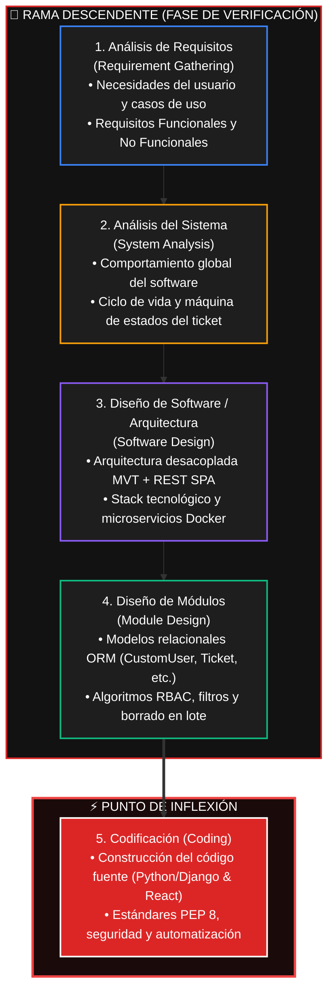
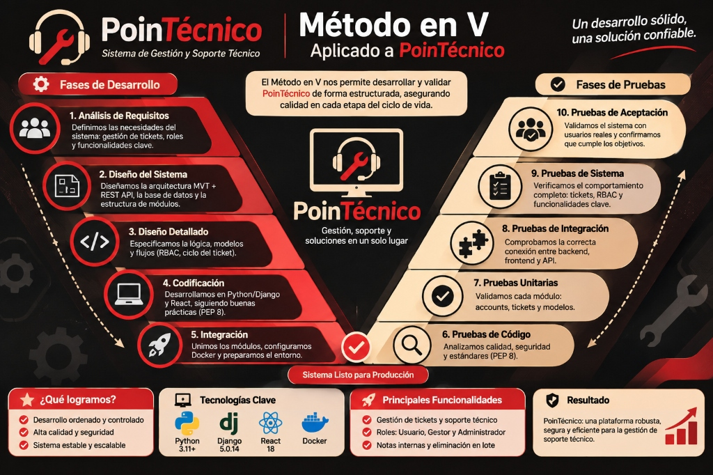

# 🛠️ PoinTécnico | Sistema de Gestión y Asignación de Soporte Técnico

<div align="center">
  
  <p><strong>Plataforma web integral para el reporte, diagnóstico, asignación técnica en tiempo real y resolución de incidencias en infraestructuras tecnológicas organizacionales.</strong></p>
</div>

<div align="center">

[-dc2626?style=for-the-badge)](https://github.com/NoelR1217/Pointecnico)
[](https://www.python.org/)
[](https://www.djangoproject.com/)
[](https://reactjs.org/)
[](https://vitejs.dev/)
[](https://www.docker.com/)
[](https://getbootstrap.com/)

</div>

---

## 📖 1. Introducción: ¿Qué es PoinTécnico?

En los entornos organizacionales modernos, la gestión ineficiente de soporte técnico genera cuellos de botella críticos: solicitudes dispersas en canales informales (correos no estructurados, mensajes de texto o llamadas), falta de visibilidad en el tiempo de respuesta, ausencia de priorización de fallas y pérdida de la memoria técnica de intervenciones pasadas.

**PoinTécnico** nace como una solución de ingeniería de software para transformar y centralizar la mesa de ayuda (*Help Desk*). Es una plataforma web robusta que implementa un modelo de **Control de Acceso Basado en Roles (RBAC)** y una arquitectura híbrida de alto rendimiento.

La plataforma permite a los colaboradores radicar tickets clasificados por categoría e impacto, mientras dota al personal técnico de herramientas avanzadas para la autoasignación inmediata de casos, el registro de diagnósticos con notas internas confidenciales, y la trazabilidad integral de cada incidencia hasta su cierre exitoso.

---

## 📌 2. Metodología de Desarrollo en V (Guía del Proyecto)

El desarrollo de **PoinTécnico** se fundamentó en la **Metodología de Desarrollo en V**, garantizando que cada nivel de especificación y diseño cuente con una correlación directa de verificación y pruebas.

### Diagrama de Flujo del Ciclo de Vida:



### Infografía Oficial del Método en V:
A continuación se presenta la infografía técnica que ilustra la correspondencia entre las fases de desarrollo descendente y sus etapas de validación y pruebas:



---

### A.1 - Contenido Detallado: Fases de la Metodología

#### 1. Análisis de Requisitos (*Requirement Gathering*)
En esta fase se identificaron las necesidades operativas de soporte técnico dentro de la organización: dispersión de solicitudes, falta de trazabilidad en los diagnósticos, retrasos en la asignación de técnicos e inexistencia de canales diferenciados para notas técnicas confidenciales.

* **Actores y Necesidades del Sistema:**
  * **Visitante:** Requiere una landing informativa y base de preguntas frecuentes (FAQ) accesible sin autenticación previa.
  * **Usuario Solicitante (Cliente / Empleado):** Requiere una interfaz clara para crear incidencias, categorizarlas, seguir su estado en tiempo real y comunicarse con el técnico asignado.
  * **Gestor Técnico:** Requiere una mesa de soporte centralizada para filtrar incidencias sin asignar, autoasignarse casos de su especialidad, registrar avances de diagnóstico y notas internas confidenciales, y depurar tickets.
  * **Administrador:** Requiere control global de usuarios, mantenimiento de categorías, auditoría general y eliminación masiva o unitaria de registros.

* **Requisitos Funcionales (RF):**
  * **RF-01 (Autenticación y Registro Segmentado):** Registro de usuarios con validación obligatoria y estricta de dominio (`@gmail.com` o `@hotmail.com`), asignando por defecto el rol `USUARIO`.
  * **RF-02 (Gestión del Ciclo de Vida de Tickets):** Creación de incidencias con prioridad (`BAJA`, `MEDIA`, `ALTA`, `CRITICA`), categorización y seguimiento en 4 estados formales (`ABIERTO`, `EN_PROCESO`, `RESUELTO`, `CERRADO`).
  * **RF-03 (Mesa de Soporte con Triaje Inteligente):** Panel de control para Gestores con 3 vistas segmentadas (*Todos los tickets*, *Cola sin asignar*, *Asignados a mí*), filtros dinámicos y métricas numéricas.
  * **RF-04 (Comunicación y Notas Confidenciales):** Muro cronológico de respuestas donde los técnicos pueden publicar notas técnicas internas visibles únicamente para el equipo de soporte.
  * **RF-05 (Eliminación Unitaria y en Lote con Confirmación):** Barra flotante de acciones masivas (*Bulk Action Bar*) para eliminar múltiples tickets seleccionados mediante checkboxes, y botones de eliminación individual protegidos por ventanas modales de confirmación.

* **Requisitos No Funcionales (RNF):**
  * **RNF-01 (Seguridad y RBAC):** Control de acceso estricto basado en roles aplicado mediante `UserPassesTestMixin` en Django y permisos personalizados en DRF.
  * **RNF-02 (Ergonomía Visual y Usabilidad):** Interfaz moderna en modo oscuro (*Dark Mode*) con rojo carmesí (`#dc2626`) como acento principal y textos de alto contraste para reducir fatiga visual.
  * **RNF-03 (Portabilidad e Integridad):** Despliegue empaquetado en contenedores Docker y transacciones ACID soportadas por el ORM.

---

#### 2. Análisis del Sistema (*System Analysis*)
Se especificó el comportamiento general del software, la arquitectura funcional y los flujos de interacción entre los diferentes componentes.

* **Máquina de Estados de la Incidencia:**
```
  [ TICKET CREADO ]
          │
          ▼
    ┌───────────┐         Autoasignación / Iniciar Diagnóstico         ┌───────────────┐
    │  ABIERTO  │ ───────────────────────────────────────────────────► │  EN PROCESO   │
    └───────────┘                                                      │(En Diagnóstico│
          ▲                                                            └───────┬───────┘
          │ Reabrir caso                                                       │
          │                                              Marcar como Resuelto  │
          │                                                                    ▼
    ┌───────────┐                       Archivar                       ┌───────────────┐
    │  CERRADO  │ ◄─────────────────────────────────────────────────── │   RESUELTO    │
    └───────────┘                                                      └───────────────┘
```

* **Reglas de Negocio Clave:**
  * **Privacidad de Incidencias:** El usuario solicitante solo puede visualizar y comentar en sus propios tickets creados.
  * **Confidencialidad Técnica:** Los comentarios marcados con `es_interno=True` se filtran y ocultan automáticamente para usuarios con rol `USUARIO` o `VISITANTE`.
  * **Depuración Segura:** La eliminación de incidencias es una potestad exclusiva de los roles `ADMINISTRADOR` y `GESTOR`.

---

#### 3. Diseño de Software / Arquitectura (*Software Design*)
El sistema implementa una **arquitectura desacoplada e híbrida** que combina renderizado en servidor (SSR) para las operaciones seguras de mesa de ayuda y una Single Page Application (SPA) reactiva para visualización en tiempo real.

```
                                      NAVEGADOR WEB (CLIENTE)
                                   ┌──────────────┬──────────────┐
                                   │              │              │
                            Puerto 8000           │        Puerto 5173
                       (Django Templates SSR)     │      (Vite React SPA)
                                   │              │              │
                                   ▼              │              │
                     ┌──────────────────────────┐ │              │
                     │    BACKEND (DJANGO 5)    │ │              │
                     │  • App 'accounts' (RBAC) │ │              │
                     │  • App 'tickets' (Core)  │◄┘              │
                     │  • REST API (DRF)        │◄───────────────┘
                     └─────────────┬────────────┘
                                   │ ORM Django
                                   ▼
                     ┌──────────────────────────┐
                     │   BASE DE DATOS SQLITE   │
                     │   (Persistencia ACID)    │
                     └──────────────────────────┘
```

* **Stack Tecnológico:**
  * **Backend:** Python 3.11+, Django Framework 5.0.14, Django REST Framework.
  * **Frontend SSR:** Django Templates, Bootstrap 5.3, Bootstrap Icons, CSS3 Moderno (Tema Carmesí / Oscuro).
  * **Frontend SPA:** Vite.js 5.0, React 18, CSS modular.
  * **Persistencia:** SQLite 3 relacional administrada vía ORM y Django Admin.
  * **Contenerización:** Docker Engine & Docker Compose (`pointecnico_backend` en `:8000` y `pointecnico_frontend` en `:5173`).

---

#### 4. Diseño de Módulos (*Module Design*)
Detalle de la lógica interna, algoritmos y esquemas relacionales por cada módulo:

* **Módulo `accounts` (Gestión de Identidad y Roles):**
  * Modelo `CustomUser` (hereda de `AbstractUser`): incorpora `rol` (`VISITANTE`, `USUARIO`, `GESTOR`, `ADMINISTRADOR`), `telefono`, `departamento` y `especialidad`.
  * Algoritmo de validación de correo (`clean_email`): extrae el dominio y verifica que pertenezca exclusivamente a `@gmail.com` o `@hotmail.com`.
  * Despachador Inteligente (`DashboardDispatcherRedirectView`): evalúa el rol tras el login y redirige a la vista correspondiente (`/gestor/panel/`, `/portal/tickets/` o `/admin/`).

* **Módulo `tickets` (Gestión Operativa):**
  * Modelos relacionales:
    * `Categoria`: clasificación técnica (`nombre`, `descripcion`, `activa`, `created_at`).
    * `Ticket`: entidad central con relaciones foráneas a `usuario_creador`, `tecnico_asignado` y `categoria`.
    * `Comentario`: trazabilidad con bandera booleana `es_interno`.
  * Vistas y Algoritmos:
    * `GestorDashboardView`: consulta con `select_related()`, particionamiento de pestañas en memoria de consulta y métricas numéricas agregadas.
    * `TicketDeleteView`: eliminación unitaria con validación `UserPassesTestMixin`.
    * `TicketBulkDeleteView`: eliminación atómica en lote que recibe la lista de IDs seleccionados mediante la barra de acciones.

* **API REST (`api_views.py`):**
  * `TicketViewSet` y `CategoriaViewSet`: serialización JSON, endpoints de autoasignación (`/api/tickets/<pk>/asignar/`), cambio de estado (`/api/tickets/<pk>/cambiar_estado/`) y borrado seguro (`destroy`).

---

### ⚡ Punto de Inflexión: Codificación (*Coding*)

Es la etapa donde las especificaciones arquitectónicas y de diseño se convirtieron en código fuente funcional y probado:

1. **Estructura Limpia y Modular:** Organización en directorios desacoplados `backend/` y `frontend/` con responsabilidades claramente delimitadas.
2. **Estándares y Buenas Prácticas:**
   * Código Python conforme al estándar **PEP 8** y tipado riguroso con `models.TextChoices`.
   * Protección contra vulnerabilidades web estándar de OWASP: tokens **CSRF** en cada formulario, consultas parametrizadas contra **Inyección SQL** mediante el ORM y escape de plantillas contra **XSS**.
   * Hasheo criptográfico robusto de contraseñas (`PBKDF2SHA256`).
3. **Población Automática de Datos Semilla (`seed_data.py`):**
   * Comando de gestión personalizado (`python manage.py seed_data`) que inicializa categorías técnicas y 4 cuentas operativas listas para demostración.
4. **Infraestructura como Código (Docker & Compose):**
   * `Dockerfile` para Python y Node.js con script de inicialización `entrypoint.sh` que ejecuta migraciones automáticas y levanta el servicio de forma resiliente.

---

## 🐳 3. Ejecución del Proyecto con Docker

### Prerrequisitos:
* Tener instalado [Docker Desktop](https://www.docker.com/products/docker-desktop/) en el equipo.

### Instrucciones de Arranque:
1. Clona el repositorio y sitúate en la raíz del proyecto:
   ```bash
   git clone https://github.com/NoelR1217/Pointecnico.git
   cd Pointecnico
   ```
2. Levanta los contenedores con Docker Compose:
   ```bash
   docker compose up --build
   ```
3. Accede a las interfaces en tu navegador:
   * **Portal Web Principal (Django SSR):** [http://localhost:8000](http://localhost:8000)
   * **Panel React SPA (Vite):** [http://localhost:5173](http://localhost:5173)
   * **Django Admin:** [http://localhost:8000/admin](http://localhost:8000/admin)

---

## 🔑 4. Credenciales Preconfiguradas para Pruebas

Todas las cuentas de prueba están configuradas con la contraseña común: **`admin1234`**

| Rol del Sistema | Usuario | Correo Electrónico | Panel de Acceso |
| :--- | :--- | :--- | :--- |
| **Administrador** | `admin` | `admin.pointecnico@gmail.com` | Django Admin (`/admin/`) + Panel Gestor |
| **Gestor Técnico** | `tecnico_carlos` | `carlos.soporte@gmail.com` | Mesa de Soporte y Asignación (`/gestor/panel/`) |
| **Gestor Técnico** | `tecnica_laura` | `laura.soporte@hotmail.com` | Mesa de Soporte y Asignación (`/gestor/panel/`) |
| **Usuario Solicitante** | `empleado_ana` | `ana.valenzuela@gmail.com` | Portal de Mis Tickets (`/portal/tickets/`) |
| **Visitante** | *(Sin login)* | — | Landing Page Pública (`/`) y FAQ (`/faq/`) |

---

## 🚀 5. Estado Actual de la Versión (v1.0.0) y Funcionalidades

El proyecto se encuentra en su **Versión 1.0.0 plenamente operativa y desplegada en contenedores**, cubriendo el 100% de los flujos de negocio requeridos:

### ¿Qué hace exactamente la versión actual?
1. **Autenticación y Registro con Restricción Institucional:**
   - Sistema de login y registro público con validación estricta de dominios de correo permitidos (`@gmail.com` y `@hotmail.com`), asignando automáticamente el rol `USUARIO` a nuevas cuentas.
2. **Ciclo de Vida Completo de Incidencias:**
   - Creación, seguimiento y transición de tickets a través de una máquina de estados: `ABIERTO` $\rightarrow$ `EN_PROCESO` (En Diagnóstico) $\rightarrow$ `RESUELTO` $\rightarrow$ `CERRADO`.
   - Niveles de prioridad estandarizados: `BAJA`, `MEDIA`, `ALTA` y `CRITICA`.
3. **Mesa de Soporte Operativo para Gestores Técnicos:**
   - Panel de control (`/gestor/panel/`) con 3 pestañas especializadas:
     * **Todos los Tickets:** Vista global de la carga de trabajo.
     * **Cola Sin Asignar:** Incidencias entrantes pendientes de atención con botón de *Autoasignación* en un clic.
     * **Asignados a Mí:** Bandeja personal de casos asignados al técnico en sesión.
   - Indicadores métricos en tiempo real (*Total en Cola*, *Sin Asignar*, *Mis Casos*, *Total Resueltos*).
4. **Muro de Comunicación y Notas Confidenciales:**
   - Hilo cronológico de respuestas entre el solicitante y el técnico.
   - Soporte de **Notas Técnicas Internas** (`es_interno=True`), invisibles para los solicitantes y resguardadas exclusivamente para el equipo de soporte.
5. **Barra de Eliminación en Lote (*Bulk Action Bar*) y Borrado Seguro:**
   - Barra flotante de herramientas que emerge dinámicamente al seleccionar uno o varios tickets mediante checkboxes, con conteo en tiempo real y modal de confirmación masiva.
   - Botón individual `[ 🗑️ Eliminar ]` en la tabla de soporte y en la vista de detalle, blindado mediante permisos de `ADMINISTRADOR` y `GESTOR`.
6. **Doble Capa de Interfaz (SSR + SPA):**
   - Vistas renderizadas en servidor con Django Templates y Bootstrap 5 en tema oscuro moderno con acentos en rojo carmesí (`#dc2626`).
   - Aplicación de página única (SPA) en React 18 / Vite.js consumiendo los endpoints de Django REST Framework en tiempo real.

---

## 📁 6. Estructura del Proyecto

El repositorio está organizado siguiendo el principio de **separación de responsabilidades** (*Separation of Concerns*), dividiendo el backend en Django, el frontend en React y la orquestación en Docker:

```text
Pointecnico/
├── docker-compose.yml              # Orquestador de servicios Backend y Frontend
├── .gitignore                      # Exclusiones de Git (node_modules, db.sqlite3, cache)
├── .env.example                    # Plantilla de variables de entorno
├── logo.jpg                        # Identidad visual de la marca
├── metodo_en_v_pointecnico.jpg     # Infografía oficial de la Metodología en V
├── README.md                       # Documentación técnica oficial del proyecto
│
├── backend/                        # NÚCLEO DEL SERVIDOR Y LÓGICA DE NEGOCIO (DJANGO)
│   ├── Dockerfile                  # Contenedor Python 3.11-slim
│   ├── entrypoint.sh               # Script de arranque: migraciones + seed_data + servidor
│   ├── manage.py                   # Gestor de comandos de Django
│   ├── requirements.txt            # Dependencias Python (Django, DRF, Pillow, etc.)
│   │
│   ├── pointecnico/                # Configuración global del proyecto Django
│   │   ├── settings.py             # Configuración central, apps, base de datos y middleware
│   │   ├── urls.py                 # Enrutamiento maestro y namespaces de apps
│   │   ├── wsgi.py / asgi.py       # Interfaces de despliegue web
│   │
│   ├── accounts/                   # MÓDULO DE IDENTIDAD, USUARIOS Y ROLES (RBAC)
│   │   ├── models.py               # Modelo CustomUser extendido con roles y validación
│   │   ├── forms.py                # Formularios de registro/login con validación de correo
│   │   ├── views.py                # Vistas de autenticación y cierre de sesión
│   │   ├── urls.py                 # Rutas de /accounts/
│   │   └── admin.py                # Personalización en Django Admin
│   │
│   ├── tickets/                    # MÓDULO CENTRAL DE GESTIÓN DE INCIDENCIAS
│   │   ├── models.py               # Modelos Categoria, Ticket y Comentario
│   │   ├── views.py                # Vistas SSR: Mesa de soporte, borrado unitario y en lote
│   │   ├── api_views.py            # ViewSets de Django REST Framework para la SPA
│   │   ├── serializers.py          # Serializadores JSON para la API REST
│   │   ├── forms.py                # Formulario de creación de ticket con validación
│   │   ├── urls.py                 # Enrutador de tickets y endpoints REST
│   │   └── management/commands/    # Comandos personalizados
│   │       └── seed_data.py        # Siembra automática de cuentas demo y categorías
│   │
│   ├── templates/                  # PLANTILLAS HTML (DJANGO SSR EN MODO OSCURO)
│   │   ├── base.html               # Layout base responsive, navbar y alertas
│   │   ├── accounts/               # login.html, register.html
│   │   └── tickets/                # gestor_dashboard.html, ticket_detail.html, etc.
│   │
│   └── static/                     # RECURSOS ESTÁTICOS COMPILADOS
│       ├── css/style.css           # Estilos personalizados (Dark/Red theme)
│       └── img/                    # Logos e infografía del proyecto
│
└── frontend/                       # APLICACIÓN REACT SPA (VITE.JS)
    ├── Dockerfile                  # Contenedor Node.js 20-alpine
    ├── package.json                # Dependencias JavaScript (React 18, Bootstrap, Vite)
    ├── vite.config.js              # Configuración del bundler y proxy reverso a Django
    ├── index.html                  # Punto de entrada HTML de la SPA
    └── src/
        ├── App.jsx                 # Componente principal interactivo de la mesa de soporte
        ├── index.css               # Estilos globales y paleta de diseño oscuro
        └── main.jsx                # Renderizado React en el DOM
```

---

## 👥 7. Autores y Créditos
* **Desarrollo y Arquitectura de Software:** **Noel Rivas** ([@NoelR1217](https://github.com/NoelR1217))
* **Proyecto Académico:** PoinTécnico - Ingeniería de Software
